# Active Directory IAM Lab with Wazuh SIEM Monitoring

A home lab where I built a Windows Server 2022 Active Directory domain, applied identity and access management (IAM) controls, and sent the domain controller's logs to my Wazuh SIEM to detect identity-related attacks.

This builds on my first project: [Home SOC Lab with Wazuh](https://github.com/jahmarleysenior99/home-soc-lab-wazuh).

> **Note:** This is a small, simulated lab for learning. It is not a production environment, and all users and passwords are fictional.

## What I built

| Area | What I did |
|---|---|
| Directory | Windows Server 2022 domain controller (DC1) for the domain `lab.local`, with a static IP |
| Structure | Organisational Units (OUs) per department, with users placed in the right OU |
| Access control | Security groups (e.g. Finance-Staff, HR-Staff) with permissions given to groups, not to individuals (RBAC / least privilege) |
| Lifecycle | Joiner, mover and leaver processes done in PowerShell |
| Policy | Password complexity, minimum length and account lockout |
| Monitoring | Wazuh agent on DC1, with detections for privilege escalation and brute-force lockout |

## Architecture

- **Wazuh server** (192.168.0.24): collects and analyses logs
- **DC1** (192.168.0.25): Windows Server 2022 domain controller, Wazuh agent `dc1`
- **My PC** (192.168.0.21): Wazuh agent `my-pc`, used to manage the lab

All machines are on the same home network, and DC1 runs as a VirtualBox VM.

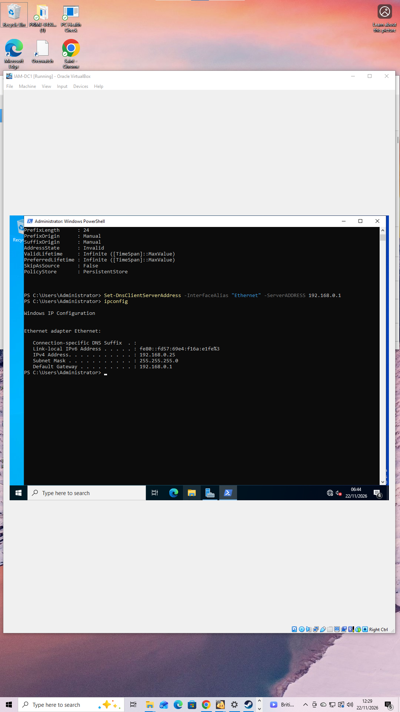
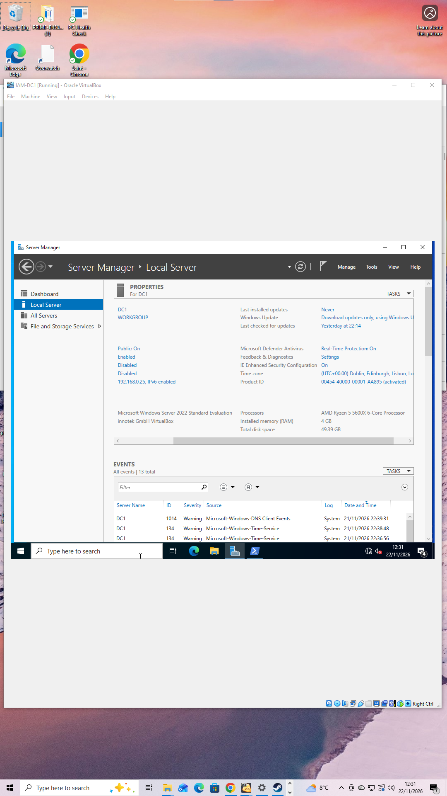

## 1. Directory design

I created the `lab.local` domain and organised it into OUs and groups so access follows job role, not individual people.

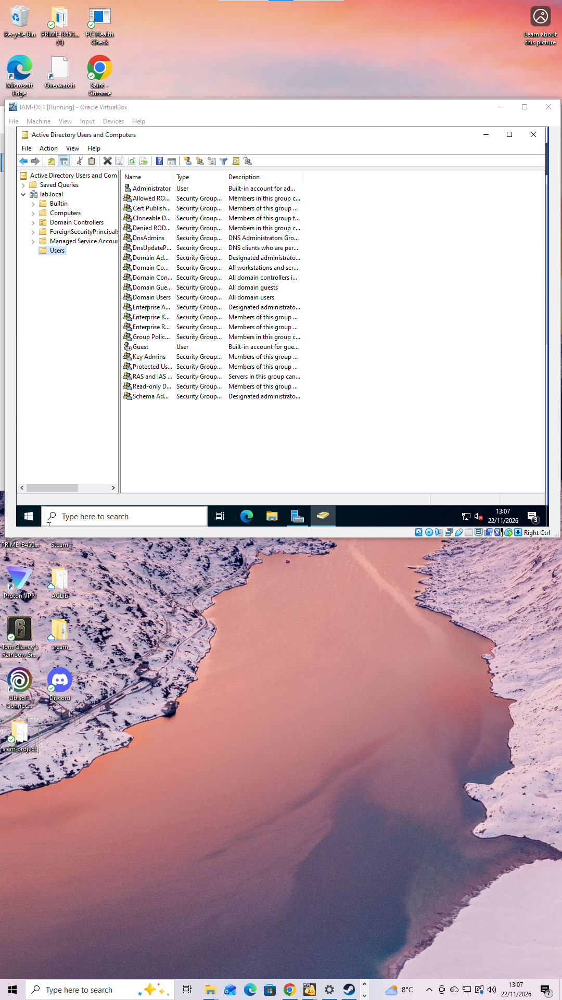
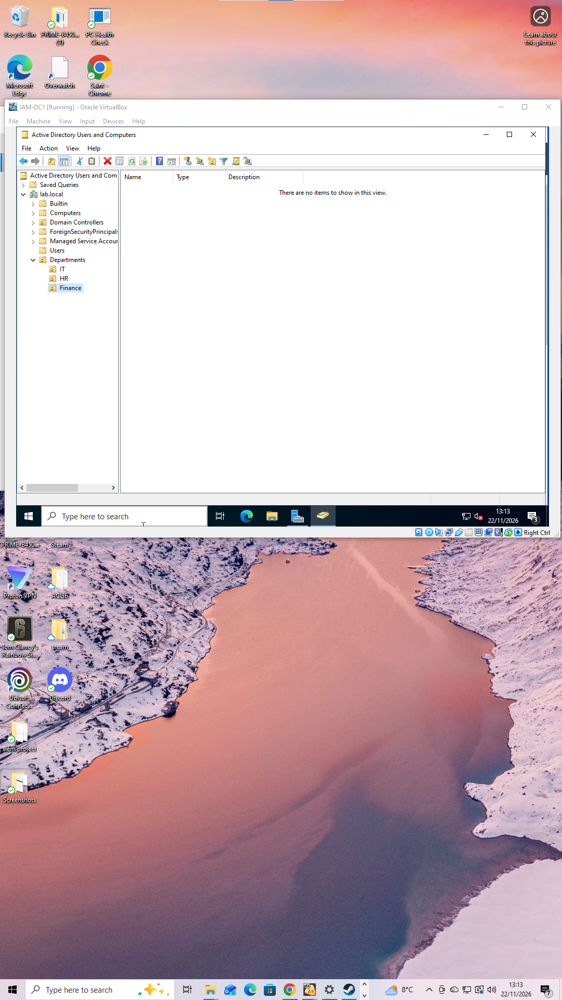
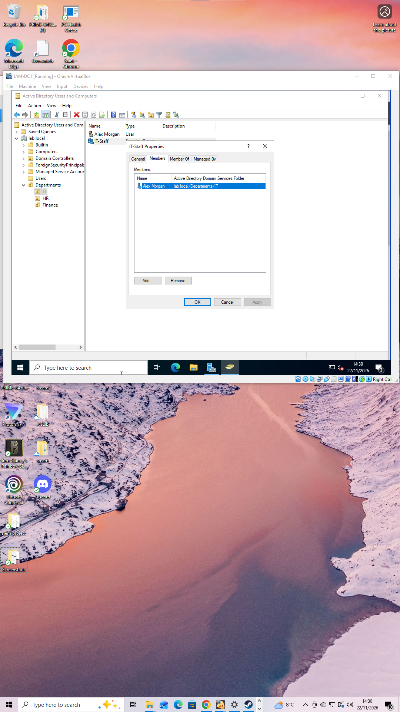

## 2. Least privilege and RBAC

Folder permissions are given to **groups**. A user gets access by being added to the right group, so access is easy to audit and easy to remove.

I proved it with the **Effective Access** tool: a member of the group is allowed in, and someone outside the group is blocked.

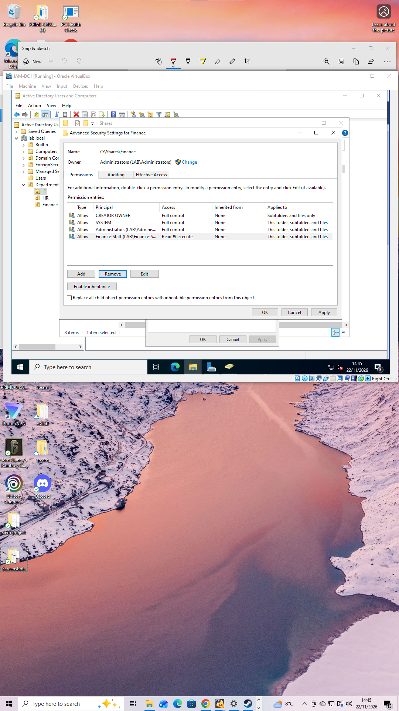
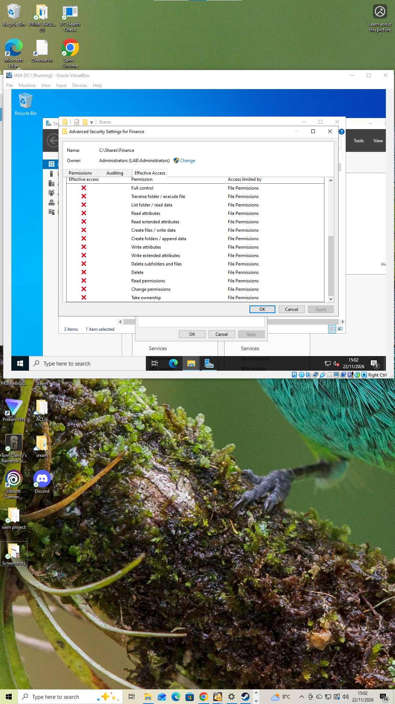
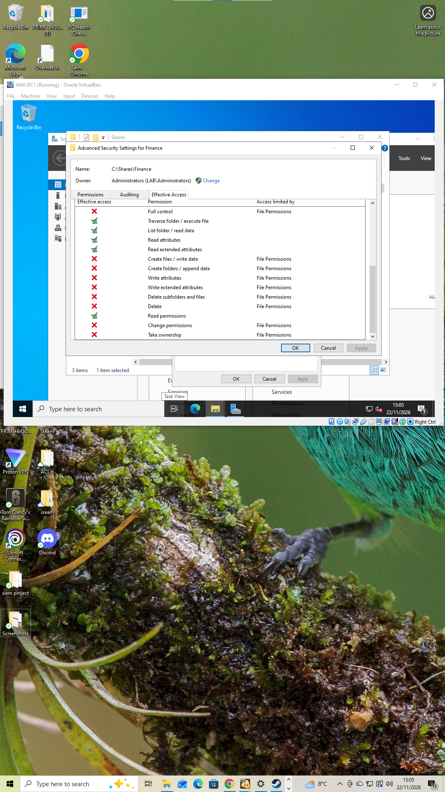

## 3. Joiner / Mover / Leaver

| Event | What I did | PowerShell |
|---|---|---|
| **Joiner** | Created a new user in the correct OU and added her to her department group | `New-ADUser`, `Add-ADGroupMember` |
| **Mover** | Moved a user between departments: removed the old group, added the new one, moved the account to the new OU | `Remove-ADGroupMember`, `Add-ADGroupMember`, `Move-ADObject` |
| **Leaver** | Disabled the account and removed group memberships | `Disable-ADAccount`, `Remove-ADGroupMember` |

The mover step matters because people who change roles and keep their old access cause **privilege creep**.

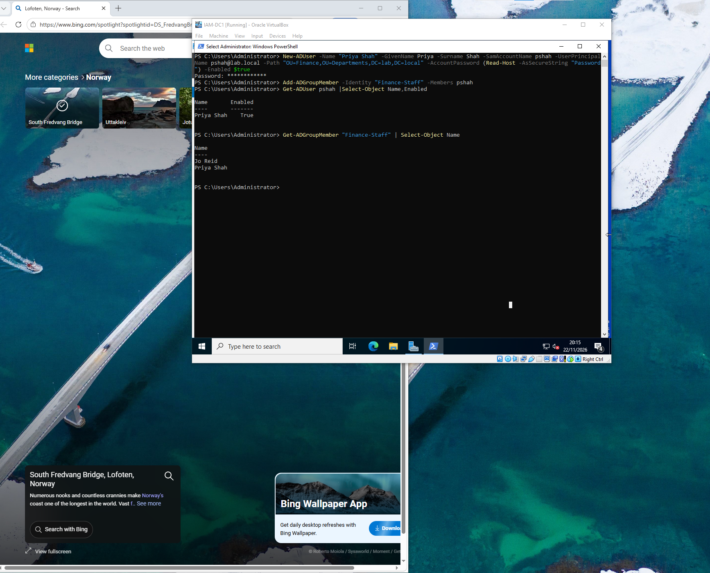
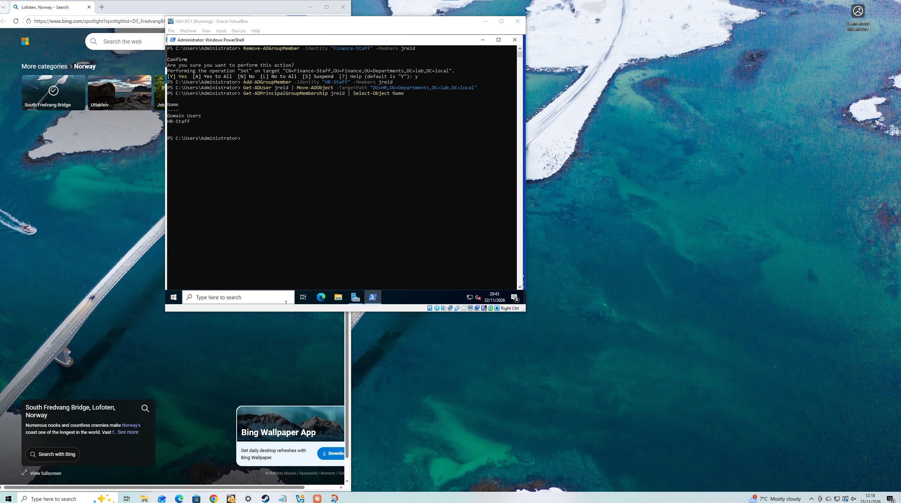
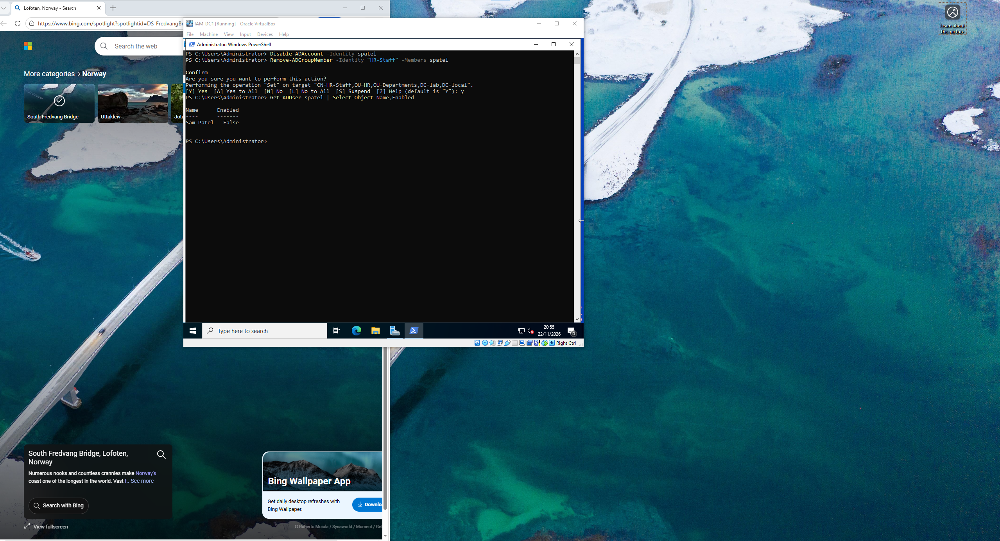

## 4. Password and lockout policy

Set on the domain with `Set-ADDefaultDomainPasswordPolicy`:

- Minimum password length: 10
- Complexity: enabled
- Lockout after 5 failed attempts
- Lockout duration and observation window: 30 minutes

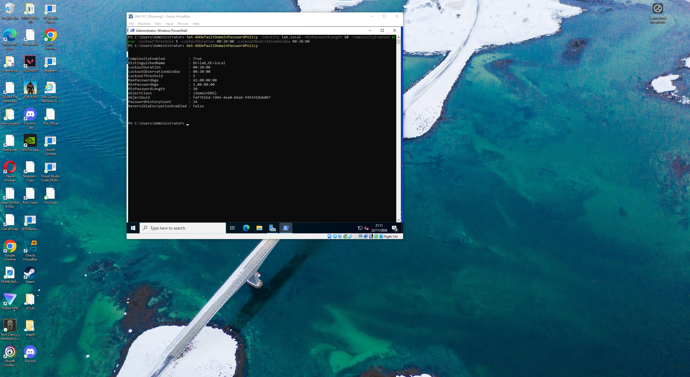

## 5. SIEM detections

I installed the Wazuh agent on DC1 so its Windows security logs reach the SIEM.

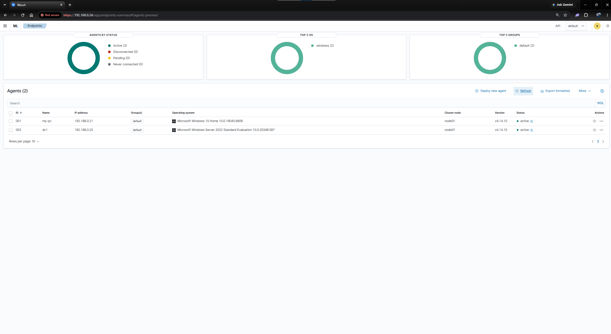

### Detection A: Privilege escalation (Domain Admins)

I simulated an attacker (or careless admin) adding a normal user to **Domain Admins**. Wazuh detected it with built-in rule **60159** ("Domain Admins Group Changed", level 12) from Windows event **4728**.

I investigated the alert in the JSON view, then **contained** it by removing the user from the group. The removal (event **4729**) was also detected.

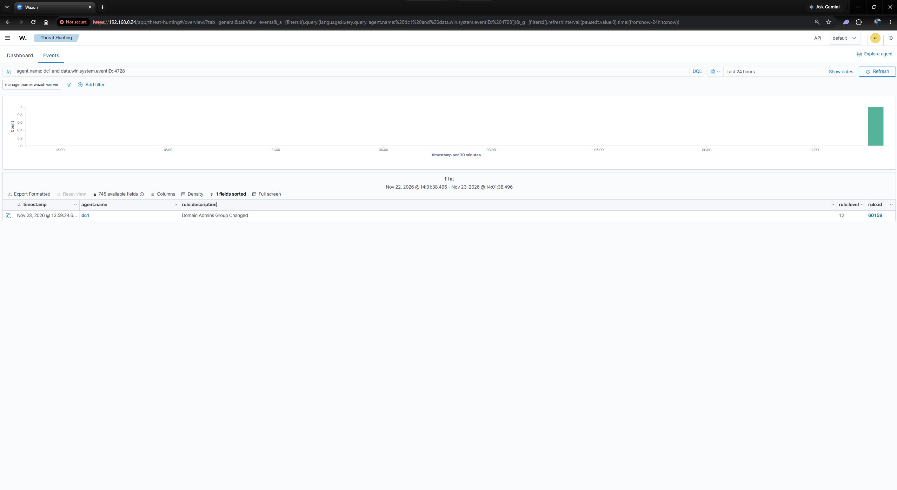
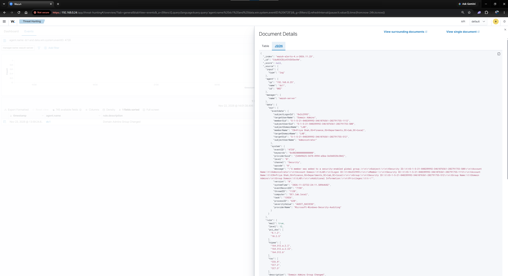

### Detection B: Brute-force / account lockout

I made repeated wrong-password attempts against a test user. The account locked out and Wazuh raised rule **60115** ("User account locked out (multiple login errors)", level 9) from event **4740**.

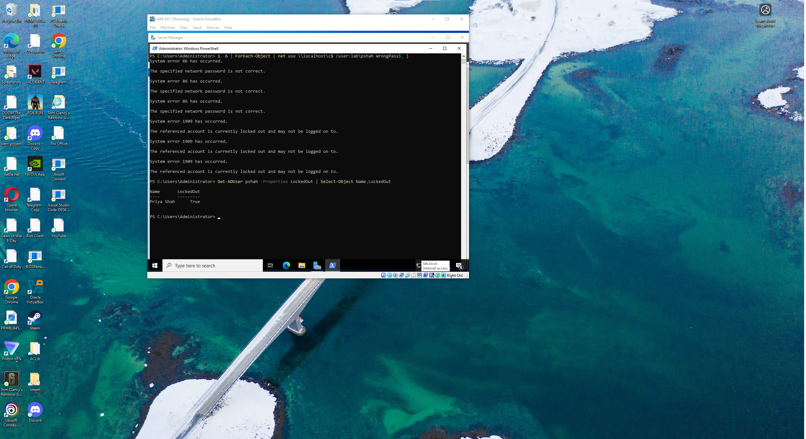
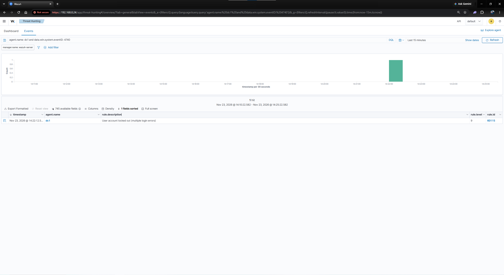

## What I learned and limitations

- **Add and remove look the same.** Rule 60159 fires for both adding and removing a Domain Admins member and only says "changed". A better setup would use separate rules: high severity for 4728 (added), informational for 4729 (removed).
- **Clock accuracy matters.** The VM's clock was about 15 hours behind, so early logs had the wrong timestamps. I fixed it with `Set-Date` and checked the new events matched the SIEM. In a real environment you would use NTP/domain time sync.
- **Lockout threshold.** Lockout triggered after fewer attempts than expected, probably because of earlier failed attempts counting toward the limit.
- **Simulated only.** This is a single domain controller with fictional users. A real environment adds multiple DCs, MFA, a privileged access model, and formal access reviews.

## Skills demonstrated

Active Directory, IAM fundamentals (RBAC, least privilege, joiner/mover/leaver), PowerShell administration, Windows event log analysis (4728, 4729, 4740), SIEM agent deployment, detection and incident response (investigate and contain), and documentation.

## Next steps

- Write a custom Wazuh rule that separates group-add (4728) from group-remove (4729)
- Add detection for new account creation (4720) and account disablement
- Add a quarterly access review process
